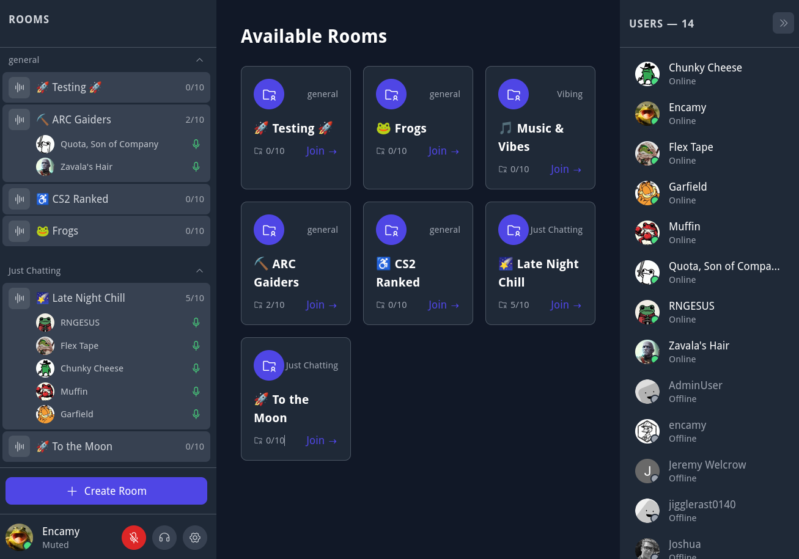
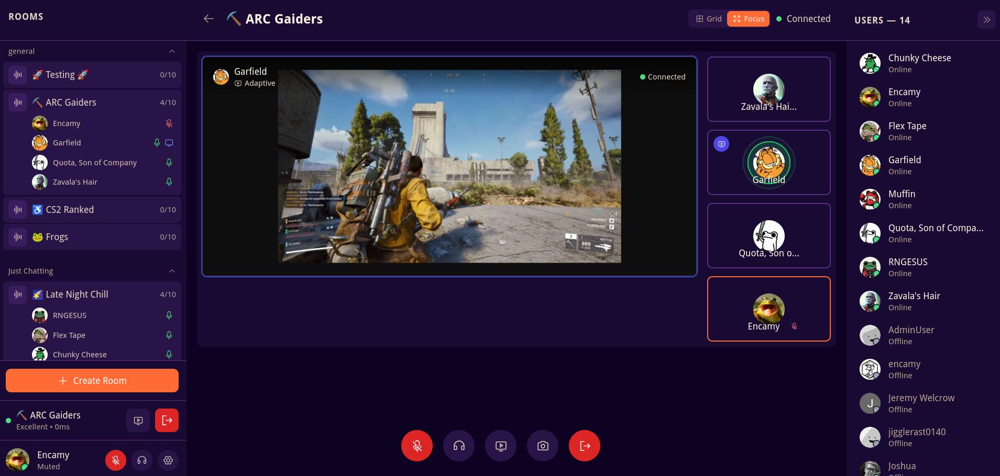
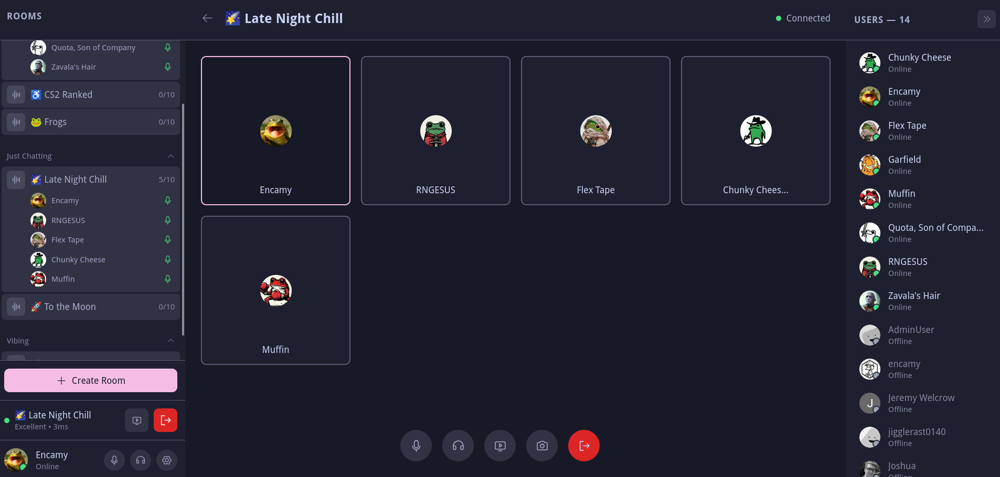
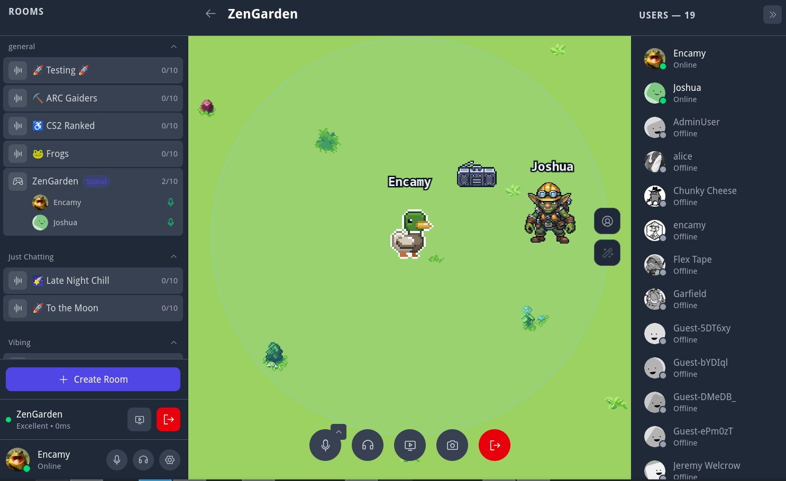
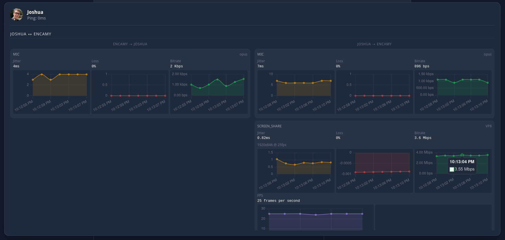

# The Orbital

A simple yet powerful voice chat for small groups of friends. Similar to Discord, but built for simplicity: voice rooms, screen sharing and persistent text channels, all self-hosted.

## AI Disclaimer

This project is built by AI (like 90%). AI is not perfect, but MVP was built in 2 weeks and it does its job. I just do not want to waste 6 months handcrafting artisanal code

## Screenshots

## Features

### Voice, video and screen sharing

- **Voice rooms** for small groups. The room size limit is configurable; LiveKit itself handles far more people per room.
- **Camera and screen sharing** with presets: Adaptive, Full HD 60 fps, Text Optimized (5 fps, sharp text for code and documents).
- **App audio sharing**: share the sound of one application (Linux + PipeWire, desktop app).
- **Noise suppression** of your choice: LiveKit, browser built-in, RNNoise (ML-based) or Speex, plus echo cancellation and automatic gain control.
- **Soundboard**: upload short clips and play them to the room.
- **Sound packs** for join/leave/mute/screen share events. Everyone hears the pack you picked, and you can override it for others ([make your own](docs/SOUND_PACKS.md)).

### Text channels

Persistent, searchable chat channels next to the voice rooms ([user guide](docs/TEXT_CHANNELS.md)):

- **Messages**: replies, `@user` and `@role` mentions with pings, reactions, pins, unicode and custom emoji, **bold** / *italic* / ~~strike~~ / spoiler formatting, edit and delete.
- **Unread state**: channels open at your last read message; unread dots and mention badges stay in sync across devices.
- **Per-channel notifications**: everything, mentions off, or muted for 1 hour to forever.
- **Attachments**: images, audio (with waveforms) and video. Each user has a storage quota (5 GB by default); when it fills up, your oldest files are removed first unless you protect them. The **My files** page shows and manages everything you have uploaded.
- **Fast search** as you type, typo-tolerant, with Discord-style filters: `from:`, `in:`, `has:image`, `during:`, `before:`, `after:`, `mentions:`, `pinned:`.
- **Search inside images**:
  - **OCR**: finds the text written in a screenshot or photo (Russian, Ukrainian, Belarusian and English).
  - **CLIP**: finds images by what they show. Search "cat on a keyboard" and get the photo, even if nobody wrote those words. Multiligual: English, Russian, Ukrainian, Belarusian (by default)

The voice room also has its own quick, temporary chat that is not saved.

### Spatial world

- A 2D map where everyone walks around as an animated character, and voices get quieter with distance.
- **Boombox**: an in-world music player that nearby people hear. Upload `.mp3` / `.opus` tracks or pick from curated ones.
- Each room can have its own world, built in Godot 4 ([how to make one](docs/SPATIAL_WORLDS.md)).

### Accounts and access

- **Sign in** with Google, Discord, email + password, or as a guest. Passwords are stored only; there are no emails and no password recovery.
- **Sign in with a QR code**: scan it from a device where you are already signed in ([how it works](docs/qr-auth-flow.md)).
- **Discord-style roles and permissions**, enforced on the server, with per-room and per-category overrides ([details](docs/PERMISSIONS.md)).
- **Custom emoji**, role colors for nicknames, avatars.

### Personalization

- **Themes**: Default, True Black, Retrowave, Catppuccin, Solarized.
- **Desktop app** for Linux and Windows with auto-updates, tray icon, global hotkeys and `orbital://` links. Download it from the [/download](https://orb.encamy.com/download) page of your server:.

### For admins

The admin panel has:
- user and role management;
- soundboard, shared audio and custom emoji management;
- a live network stats dashboard (jitter, packet loss, bitrate, codec, resolution and FPS per track);
- usage analytics;
- a security self-check;
- the image search indexing status.

## Self-hosting

The minimum is the backend, the frontend and LiveKit. Text channels also need Meilisearch. Attachments and image search are optional and need S3 storage (Garage) and an Immich machine-learning service. Each optional part turns itself off when it is not configured.

- [Deployment](docs/DEPLOYMENT.md): production setup, ports, reverse proxy, optional services.
- [Configuration](docs/CONFIGURATION.md): every setting and environment variable.
- [Backups and restore](docs/notes/BACKUP_RESTORE.md).

## Development

See [Development](docs/DEVELOPMENT.md) for prerequisites, `make` commands and tests.

## Known issues

### Screen share audio with some wireless headsets (Windows)

On Windows, screen share audio can only be captured from the **default playback device**, and some drivers (**Logitech** wireless headsets in particular) don't support capturing it at all. Orbital then shares video only. There's no workaround: capturing a single app's audio the way Discord does would need DLL injection, which is out of reach for this project (and antivirus/anticheat software doesn't like it).

## Documentation

| Document | Contents |
|---|---|
| [docs/TEXT_CHANNELS.md](docs/TEXT_CHANNELS.md) | Text channel guide: formatting, search syntax, attachments, image search |
| [docs/PERMISSIONS.md](docs/PERMISSIONS.md) | Roles, permissions, room overrides |
| [docs/DEPLOYMENT.md](docs/DEPLOYMENT.md) | Production deployment |
| [docs/CONFIGURATION.md](docs/CONFIGURATION.md) | Configuration reference |
| [docs/DEVELOPMENT.md](docs/DEVELOPMENT.md) | Tech stack, local setup, commands, tests |
| [docs/SPATIAL_WORLDS.md](docs/SPATIAL_WORLDS.md) | Building worlds in Godot |
| [docs/SOUND_PACKS.md](docs/SOUND_PACKS.md) | Creating sound packs |
| [docs/qr-auth-flow.md](docs/qr-auth-flow.md) | QR code sign-in protocol |
| [docs/specs/CHAT_SYSTEM.md](docs/specs/CHAT_SYSTEM.md) | Text channel design spec |
| [docs/notes/](docs/notes/) | Backups, release storage, runner notes |
