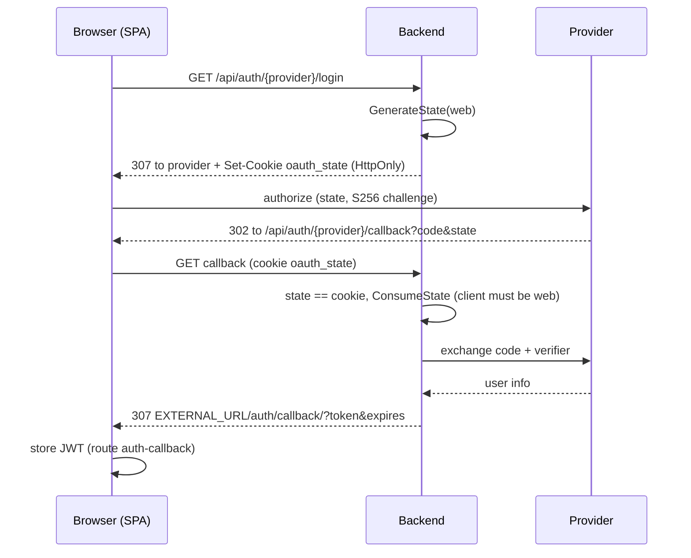
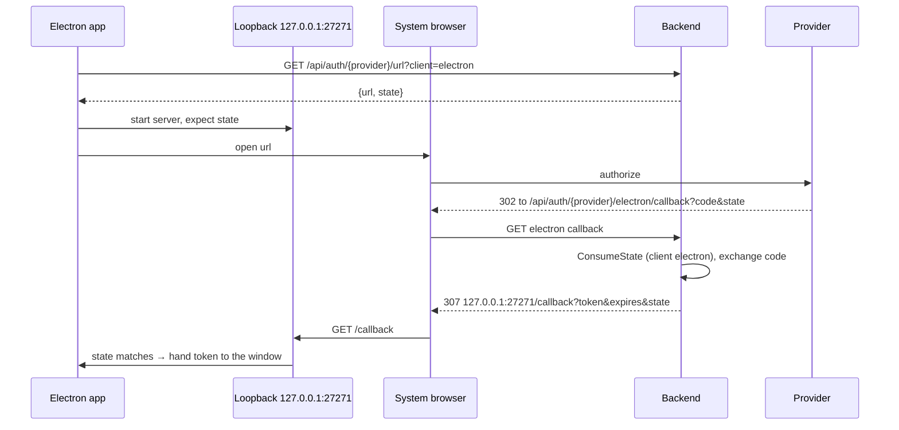
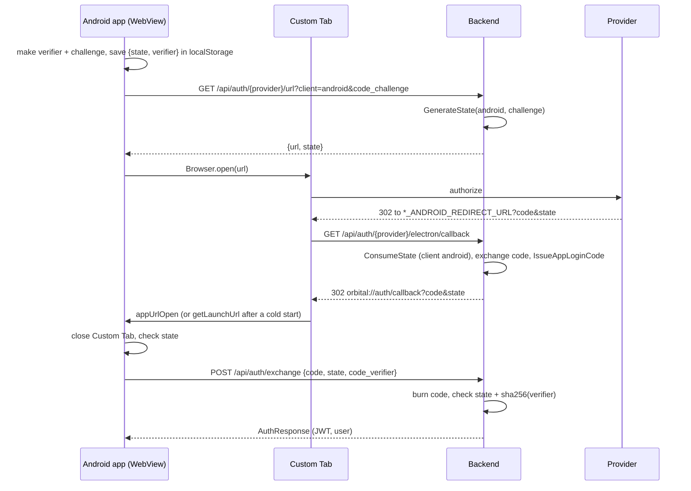

# OAuth sign-in (Discord, Google)

Three clients sign in with OAuth. All of them use PKCE (S256) toward the provider
and a one-time, server-side `state` (5 min TTL). They differ in how the result
gets back to the client:

| Client | Starts with | Provider redirect URI | Final hop |
|---|---|---|---|
| Web | `GET /api/auth/{provider}/login` | `*_REDIRECT_URL` → `/api/auth/{provider}/callback` | `EXTERNAL_URL/auth/callback/?token=…` |
| Desktop (Electron) | `GET /api/auth/{provider}/url?client=electron` | `*_ELECTRON_REDIRECT_URL` → `/api/auth/{provider}/electron/callback` | `http://127.0.0.1:27271/callback?token=…&state=…` (loopback server) |
| Android (Capacitor) | `GET /api/auth/{provider}/url?client=android&code_challenge=…` | `*_ANDROID_REDIRECT_URL`, falling back to `*_ELECTRON_REDIRECT_URL` (same `/electron/callback` route) | `orbital://auth/callback?code=…&state=…` (deep link), then `POST /api/auth/exchange` |

QR device linking ([`qr-auth-flow.md`](./qr-auth-flow.md)) is a separate sign-in
path that doesn't involve a provider.

Code: `backend/internal/handlers/authhandler.go` (routes), `backend/internal/service/authservice.go`
(state, provider configs, code exchange), `backend/internal/service/oauthapp.go` (client
kinds, Android login codes), `frontend/src/services/api.ts` (`initiateOAuthLogin`),
`frontend/src/services/oauthApp.ts` (Android), `electron/main/features/oauth.ts` (loopback).

## Common part

- `AuthService.GenerateState(provider, client, appChallenge)` stores
  `{provider, client, PKCE verifier, app challenge}` under a random state. The client kind
  (`web` / `electron` / `android` / `android-dev`) is part of the state, so a callback
  only accepts states from its own flow: the web callback rejects app states and
  vice versa.
- `ConsumeState` deletes the state on first use. The callback then exchanges the
  provider code with the stored verifier, creates or updates the user and makes the
  first non-guest user super admin (`completeOAuthLogin`).
- The provider redirect URI is chosen per client (`AuthService.clientOAuthConfig`)
  and must be registered in the provider's console.

## Web

The state cookie ties the callback to the browser that started the flow (login
CSRF protection). Post-login redirects only ever go to `EXTERNAL_URL`.

## Desktop (Electron)

The port must match `OAUTH_CALLBACK_PORT` in `electron/main/features/oauth.ts`.

## Android

A phone has no loopback listener, so the app callback ends with a deep link instead.
Any app can register a URL scheme, so the deep link carries a **one-time login code,
never the JWT**: the code is single-use (burned on the first attempt, even a failed
one), lives 60 s, and is bound to the state and to the app's S256 challenge. Only the
app holding the matching verifier can redeem it.

Details:

- **Two schemes.** The "Orbital Dev" build (`app.orbital.dev`) installs next to the
  production app and uses `orbital-dev://` (client `android-dev`). The scheme lives in
  three places that must match: `OAuthClient.AppCallbackURL` (backend, a fixed list,
  never taken from the request), `manifestPlaceholders.oauthScheme` in
  `mobile/android/app/build.gradle` (used by the `intent-filter` in
  `AndroidManifest.xml`), and the `.dev` app-id check in `oauthApp.ts`.
- **Pending flow in localStorage.** Android may kill the app while the Custom Tab is
  open, so `{state, verifier}` survives in localStorage (5 min) and `setupAppOAuth`
  (from `useNativeShell`) also checks `App.getLaunchUrl()`.
- Errors surface in `AuthView` through `appOAuthError`.
- **Redirect URI in development.** The Electron URIs in dev point at
  `http://localhost:3000`, which the phone can't reach. Set
  `*_ANDROID_REDIRECT_URL` to the dev tunnel
  (`https://orb-dev.encamy.com/api/auth/{provider}/electron/callback`) and register it
  with the provider. Google only accepts plain `http://` for localhost. In production
  the fallback to the public Electron URIs is enough.
- Possible later step: verified App Links (`https://<domain>/.well-known/assetlinks.json`)
  instead of a custom scheme. They remove the interception risk but need the release
  signing key's fingerprint.

## Configuration

| Variable | Used by |
|---|---|
| `DISCORD_REDIRECT_URL`, `GOOGLE_REDIRECT_URL` | Web |
| `DISCORD_ELECTRON_REDIRECT_URL`, `GOOGLE_ELECTRON_REDIRECT_URL` | Desktop, and Android fallback |
| `DISCORD_ANDROID_REDIRECT_URL`, `GOOGLE_ANDROID_REDIRECT_URL` | Android (optional) |
| `EXTERNAL_URL` | Web final redirect |
| `RATE_LIMIT_OAUTH_PER_MINUTE` / `RATE_LIMIT_AUTH_PER_MINUTE` | `/url` / `/exchange` |

## Tests

`backend/internal/service/oauthapp_test.go` (login code single use, expiry, wrong
state/verifier) and `backend/internal/handlers/authhandler_test.go` (client parsing,
redirect URI per client, cross-flow state rejection, `/auth/exchange`).
