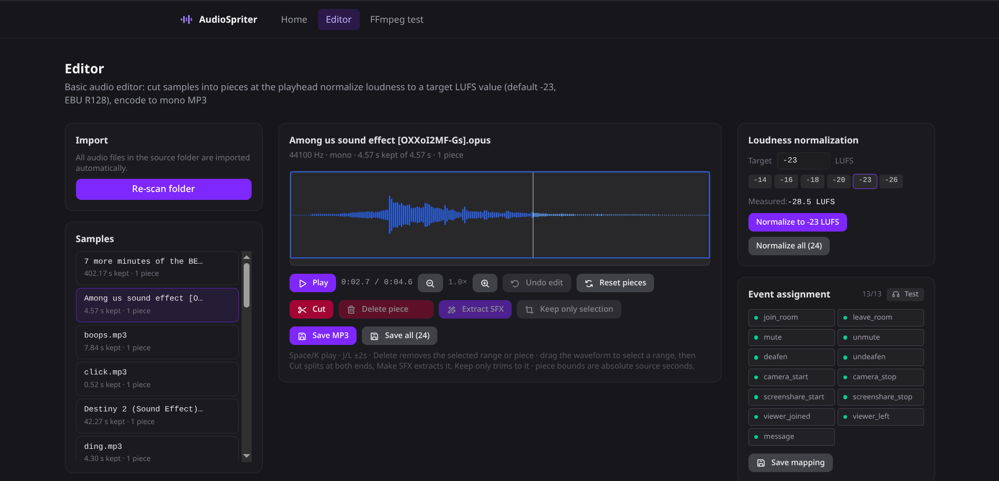

# Sound Packs

UI sound effects come from sound packs. A pack is one audio sprite (a single audio file holding every sound) plus a definition of where each sound starts and how long it lasts. Each user picks a pack in settings, and other people hear that pack for their events (they can override it locally).

There are two ways to make a pack:

- the editor at [audiospriter.encamy.com](https://audiospriter.encamy.com/);
- the manual steps below.



## 1. Gather the samples

Name your audio files after the events:

| Event | Played when |
|---|---|
| `join_room` | someone joins a voice room |
| `leave_room` | someone leaves a voice room |
| `mute` / `unmute` | someone mutes or unmutes |
| `deafen` / `undeafen` | someone deafens or undeafens |
| `camera_start` / `camera_stop` | someone starts or stops their camera |
| `screenshare_start` / `screenshare_stop` | someone starts or stops sharing their screen |
| `viewer_joined` / `viewer_left` | someone starts or stops watching your screen share (played only for you) |
| `message` | an in-call chat message notification appears |
| `reconnecting` / `reconnected` | the connection drops and comes back |

Text channel mentions use a separate built-in chime that is not part of the packs.

## 2. Build the sprite

```bash
# audiosprite is a separate tool: https://github.com/tonistiigi/audiosprite
audiosprite --output pack_name *.mp3
```

This writes the audio files and a sprite definition, `pack_name.json`.

## 3. Add the audio

Put the audio files in `frontend/public/assets/sounds/sprite/<pack_name>/`, next to the existing packs.

## 4. Convert the definition to TypeScript

Put `pack_name.json` in the `frontend/` directory and run, from `frontend/`:

```bash
pnpm run convert:soundsprite -- pack_name.json
```

This writes `frontend/src/services/sprites/packName.ts`.

## 5. Register the pack

Import the generated sprites in `frontend/src/services/sounds.ts` and add the pack to `soundPacks`.
