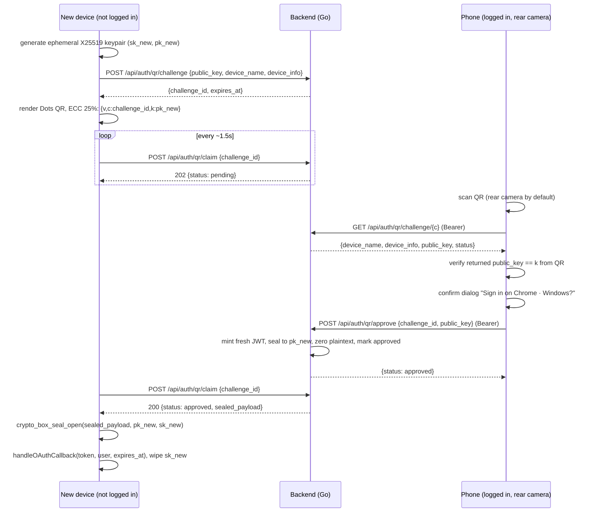

# QR device linking ("Sign in with QR code")

Single-use, end-to-end-encrypted device pairing. The new device shows a QR
code; a logged-in, non-guest device scans it (Settings → Security → Scan QR
code) and approves the sign-in after seeing the new device's name.

Guest accounts can neither start from a linked session nor approve linking:
device linking is for real accounts only.

## Flow

## Security model

- The QR code carries **only public values** (`challenge_id`, `public_key`).
  Nothing token-bearing is ever encoded, displayed, or logged.
- The session token is delivered as a **libsodium sealed box**
  (`crypto_box_seal` ↔ Go `nacl/box.SealAnonymous`). Only the ephemeral
  private key — generated in memory on the new device and never transmitted —
  can open it. A photographed QR code is useless to an attacker.
- Honest caveat: the server issues the JWT, so it transiently holds the
  plaintext at mint time. Guarantees: never persisted, never logged, never
  sent anywhere except sealed to the new device's key, single-use atomic
  consume.
- The scanning device verifies the server-presented public key matches the
  one from the QR code, detecting a key-swapping intermediary.
- 256-bit random challenge ids, **~2 minute TTL**, single-use challenges,
  per-IP rate limits on creation/approval, `Cache-Control: no-store`.
- Interop is pinned by tests both ways: Go opens a libsodium-sealed vector
  (`backend/internal/service/qrloginservice_test.go`) and libsodium opens a
  Go-sealed vector (`frontend/src/services/qr.test.ts`).

## Endpoints

| Method | Path | Auth | Purpose |
| ------ | ---- | ---- | ------- |
| POST | `/api/auth/qr/challenge` | no | Register a pending challenge for an ephemeral public key |
| GET | `/api/auth/qr/challenge/{id}` | yes | Metadata for the approval dialog (no sealed payload) |
| POST | `/api/auth/qr/approve` | yes, non-guest | Seal a fresh JWT to the challenge key |
| POST | `/api/auth/qr/claim` | no | Poll: `202` pending, `200` approved (once), `404`/`410` over |

## UI map

- New device: `AuthView.vue` → "QR code" tab → `components/auth/QRLoginPanel.vue`
  (Dots QR via `services/qr.ts` `renderDotsQR`, countdown, polling).
- Existing device: Settings → **Security** tab
  (`components/settings/SecuritySettings.vue`, wired into both
  `SettingsModal.vue` and `MobileSettingsModal.vue`) → `Scan QR code` →
  `components/auth/QRScanModal.vue` (rear camera via `qr/dom.js`,
  confirmation dialog, approve/deny).
